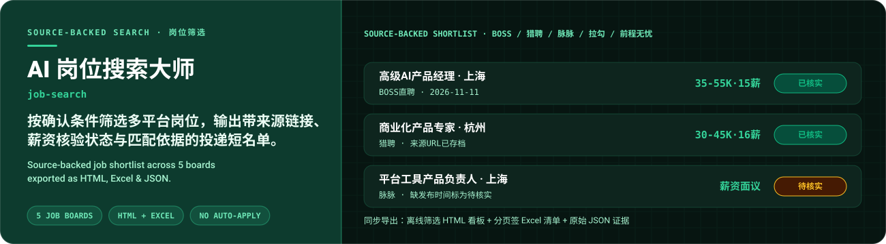

# AI岗位搜索大师（job-search）｜求职岗位筛选与招聘信息整理 Agent Skill

<!-- discovery:start -->
## 中文 AI 求职岗位搜索与招聘信息筛选

**怎样按城市、薪资和发布日期筛选招聘岗位？** 先确认求职条件，再通过可访问的招聘来源整理 HTML、Excel、JSON 岗位清单，保留来源、日期依据和待核实项。

Chinese job search agent and source-backed job hunting shortlist.

**开始使用：** [安装与首次搜索](#quick-start) · [查看输入输出示例](#quick-example)。

**使用边界：** 发布时间与刷新时间分开记录；登录、验证码和平台访问限制可能影响覆盖，未核实岗位不充作有效短名单，不代投或联系 HR。

[按任务浏览欧八同学的全部工具](https://github.com/ouxxyy/ouba-classmate#按需求找)；如果本项目有帮助，欢迎收藏当前仓库。

<!-- discovery:end -->

<!-- hero:start -->

<p>
  <a href="https://github.com/ouxxyy/ouba-classmate"></a>
</p>

**用一句话描述目标城市、薪资带与公司阶段，按确认条件查询可访问的招聘平台和本地招聘来源，去重整理出带来源与待核实项的 HTML、Excel 与 JSON 投递短名单。**<br>
<sub>Chinese job search agent checking accessible recruitment sources and exporting evidence-backed HTML, Excel and JSON shortlists; unverified listings remain separate.</sub>

<p>
  <a href="https://github.com/ouxxyy/ouba-classmate"></a>
  <a href="#quick-example"></a>
  <a href="#quick-start"></a>
  <a href="#english-overview"></a>
  <a href="https://github.com/ouxxyy"></a>
</p>


<!-- hero:end -->

[](https://merx.help/shield)

**把求职条件，整理成一份有来源、有理由、能逐条核实的投递短名单。**

找工作时，麻烦的往往不是搜不到岗位，而是开了几个招聘网站，仍要一条条比薪资、看发布日期、记下哪里还缺信息。我做了这个 Skill，让 Agent 按你确认的条件去找，把结果放进同一份 HTML 和 Excel。你决定投哪些，它不会代投或联系 HR。

可以直接给条件，也可以提供简历，让 Agent 先建议方向。**简历里推导出的新方向，要经你确认才会搜索。**


上图由程序自带的虚构数据生成，演示报告筛选、来源核实和本地标记；不是实时招聘结果，也不表示已找到 25 个岗位。

> [!TIP]
> 🎁 扫码关注公众号「欧八同学」，免费领取 AI 案例与 Skill《大厂产品AI经验编程 200 套》→ [去扫码](#author)

[使用示例](#quick-example) · [开始使用](#quick-start) · [English](#english-overview)

<a id="quick-example"></a>

## 一次使用示例

**输入示例：**

```text
帮我找上海或杭州的高级产品经理岗位，月薪 30K 以上。
先确认条件和平台，再搜索；缺薪资或发布时间的岗位单独标为待核实。
```

**输出：** 同一份 HTML、Excel 和 JSON 岗位清单，保留来源链接、采集时间、匹配依据和待核实项。数量不足会如实显示，不拿未核实岗位补足目标。

[安装并开始搜索](#quick-start)。上方演示使用虚构数据，不是这组条件的实时搜索结果。

## 最后会拿到什么

- **HTML 报告**：搜索、分类、平台筛选、薪资与日期排序、查看原始依据、本地标记、CSV 导出；离线可用。
- **Excel 清单**：把优先投递、待核实、备选、排除分开，方便自己跟进。
- **覆盖情况**：每个平台找到了多少、还差多少，哪些在等登录，哪些信息没能核实。
- **JSON 数据**：保留岗位来源、采集时间和判断依据，便于后续整理。

<details>
<summary>查看报告截图</summary>


</details>

## 它会怎么找

1. 你给出岗位、城市、薪资等条件；简历是可选输入。
2. Agent 列出搜索计划，等你确认方向、平台和数量。
3. 先检查 Tabbit 已有标签，复用可用的求职页面；确实遇到登录墙或验证码，再请你操作。
4. 逐个平台搜索并核实证据，生成报告，说明没有完成的部分。

新计划默认搜索 BOSS直聘、猎聘、脉脉、智联招聘、前程无忧及目标地区本地宝，目标是**每个平台 5 个符合条件的岗位，共 30 个**。也可以指定每个平台 10 个，或给各平台不同数量。目标不等于承诺：缺少发布日期、薪资不完整的岗位会进入“待核实”，不拿来凑数。

<a id="quick-start"></a>

## 安装

需要 Python 3.10+、能执行本地命令的 Skill 宿主，以及 [Tabbit 浏览器](https://www.tabbit.com/)的稳定 CLI。Apple 芯片 Mac 选择 Apple Silicon 版；也可从[国际站下载](https://www.tabbit.ai/download)。在 Tabbit 中按客户端说明启用 CLI，详见 [Tabbit 操作说明](references/tabbit.md)。

### macOS / Linux

```bash
git clone https://github.com/ouxxyy/job-search.git
cd job-search
python3 -m venv .venv
.venv/bin/python -m pip install -r requirements.txt
.venv/bin/python job_search.py doctor
.venv/bin/python install.py --target ~/.agents/skills
```

`install.py` 将当前目录链接到宿主的 `skills/job-search`，不会覆盖已有的不同目录。请保留克隆目录。Claude Code 用户将最后一行的目标换成 `~/.claude/skills`；其他宿主使用各自的 Skill 目录。

### Windows

在 PowerShell 中克隆仓库后，使用副本安装：

```powershell
git clone https://github.com/ouxxyy/job-search.git
cd job-search
py -3 install.py --target "$env:USERPROFILE\.agents\skills" --copy
cd "$env:USERPROFILE\.agents\skills\job-search"
py -3 -m venv .venv
.\.venv\Scripts\python.exe -m pip install -r requirements.txt
.\.venv\Scripts\python.exe job_search.py doctor
```

实机检查覆盖 macOS arm64；Windows / Linux 路径有处理，但尚未完成对应系统的端到端验证。`doctor` 只检查依赖和启动器路径，不代表招聘平台已登录。

## 第一次使用

装好后，在 Agent 中说：

> 用 job-search 帮我找上海财务分析师，月薪 15–30K，近两个月发布，每个平台 5 个。先列筛选条件让我确认，再用 Tabbit 搜索，给我 HTML 和 Excel 投递短名单。

也可以明确补充当地和公共渠道：

> 帮我找苏州电工，查苏州本地宝、中国公共招聘网和国聘，各 5 个。岗位工作地点必须在苏州；招聘公告请核实原文、报名截止和资格，已经截止的排除。

也可以带上简历：

> 根据这份简历帮我找采购岗位。其他适合的方向可以建议，但我确认后才能加入搜索。不要帮我投递。

想先看报告长什么样，可以运行离线演示，不需要登录招聘网站：

```bash
.venv/bin/python job_search.py demo --out ~/job-search-runs/demo
```

用浏览器打开输出目录里的 `jobs.html`；同目录有 `jobs.xlsx` 和 JSON。所有演示公司、岗位和平台状态都是虚构的。

完整 CLI 示例、计划生成和断点恢复见 [命令说明](references/cli.md)；简历读取由宿主负责，CLI 没有内置 OCR 或大模型客户端。

## 平台方式与限制

| 平台 | 当前方式 |
|---|---|
| BOSS直聘、猎聘 | 通过 Tabbit 读取正常页面产生的响应；页面变化时可转由 Agent 操作界面 |
| 脉脉、智联招聘、前程无忧 | Agent 用 Tabbit 操作实际搜索控件、整理证据，汇入同一报告 |
| 本地宝 | 按用户期望地区定位城市站，Agent 检索职位及招聘公告，回溯原始来源和报名期限 |
| 国聘、中国公共招聘网、国家大学生就业服务平台 | 按国企、公服就业、应届等场景确认后，Agent 检索并核验资格 |
| 鱼泡直聘、实习僧 | 按岗位场景补充，经用户确认后走界面流程 |

单独运行 Python 时，需要界面操作的平台会返回 `guided_pending`。Agent 要继续处理 `next-actions.json`，不能把这当成搜索结束。脉脉部分功能可能需要 App；账号权限、验证码和平台改版都可能影响覆盖，报告会保留缺口。操作依据见 [平台手册](references/platforms.md)。

- 默认要求近 60 天发布，优先近 7 天 HR 活跃；可以调整。**刷新时间不当作首次发布时间，在线不代表会回复。**
- 薪资按月薪 K 比较，年薪、日薪、时薪不擅自折算；区间下限低于你的底线会进入待核实。
- 规则排序分不是录用概率。通勤、单双休、转行接受度等自由文本要求，仍需人工核实。
- 新计划按查询规模与目标数量生成独立预算；普通每平台 5 岗默认 6 个结果页、30 次详情尝试，分批使用，达标即停。旧计划及用户指定上限原样保留，扩容须确认。报告区分尝试与成功读取，核对两类预算再判断能否结束，详见 [浏览预算](references/budget.md)。
- 默认单 Agent 串行。模型 429 暂停整轮调用；招聘平台 HTTP 429 只停止该平台。页面置空时保留已取得的证据，按状态暂停或恢复，不保证冷却后一定可用。
- 目前未完成全部渠道的完整在线验收；离线回归通过不代表平台持续可用，也不保证岗位仍在招聘。

本地宝城市路线来自官方城市导航，收录 379 个地区首页；未收录或歧义地区从城市导航核对，不猜地址。该数字不代表全部城市招聘功能已实测。新渠道均为 Agent 界面流程，已有计划不自动扩大范围。详见 [本地渠道操作](references/local-sources.md) 与 [入口核验记录](references/source-verification.md)。

## 隐私与开发

真实计划、简历和报告请放仓库外。项目不保存 Cookie / 令牌，不自动上传简历；宿主如何处理简历由该宿主决定。报告无 CDN、外部字体和统计脚本，本地标记只保存在当前浏览器。

开发检查（需要 Node.js 22 和已安装 Python 依赖）：

```bash
.venv/bin/python -m unittest discover -s tests -v
node --test tests/test_collect.cjs tests/test_page_state.cjs
.venv/bin/python build_package.py --out ~/job-search-release
```

发布包按显式文件清单构建，不包含虚拟环境、私人报告或备份。验证范围见 [验证说明](references/verification.md)，数据格式见 [数据约定](references/data-contract.md)。

## 常见问题

### 它会自动投递、联系 HR 或上传简历吗？

不会。项目整理清单，投递由你决定；简历是可选材料，不自动上传。

### 能先根据简历建议方向吗？

可以先提出建议，但从简历推导出的新方向必须经你确认后才搜索。

### 能保证每个平台找到足够的岗位吗？

目标数量不代表承诺。登录受限、证据不足或条件不符会单独记录，未核实项不算已确认匹配。

### 跨平台与系统支持验证到哪一步？

需要 Python 3.10+ 和 Tabbit 稳定 CLI。目前实机覆盖 macOS arm64，Windows/Linux 与全部渠道的完整在线流程仍有未验证项。

<a id="english-overview"></a>

## English overview

Job Search is a job search Agent Skill that turns confirmed criteria into source-backed HTML, Excel and JSON job lists. It keeps source links, collection times, matching reasons and unresolved fields. It does not apply for jobs, contact recruiters or upload a resume automatically.

See [installation](#quick-start). Python 3.10+ and Tabbit's stable CLI are required. Directions inferred from a resume require confirmation. Full logged-in acceptance across all supported recruitment channels and end-to-end Windows/Linux validation remain incomplete.

## 改名与兼容

项目原名 Job Scout，现统一使用 **Job Search / job-search**，对外中文名 **AI岗位搜索大师**。GitHub 旧地址保留跳转；新安装使用 `skills/job-search` 和 `job_search.py`。

已有脚本仍可运行 `job_scout.py`，若移动已有源码目录，请保留旧路径软链接或重建虚拟环境。内部 `jobscout` 模块、`JOB_SCOUT_STATE_DIR`、锁目录与报告本地标记键保持兼容，不需要移动既有求职结果。旧技能入口请重新安装或重载为 `job-search`；安装器只清理指向同一源码的旧软链接，不删除旧的真实目录。

<!-- suite-matrix:start -->

## 更多开源项目 · More from ouba-classmate Suite

> 如果这个项目帮到了你，欢迎去旗舰合集仓 [**`ouxxyy/ouba-classmate`**](https://github.com/ouxxyy/ouba-classmate) 点一颗 Star 或一行安装全部 Skills：
> `npx skills add ouxxyy/ouba-classmate` · `gh api -X PUT /user/starred/ouxxyy/ouba-classmate`

| 仓库 · Repo | 分类 · Category | 它做什么 · What it does |
| --- | --- | --- |
| [`ouba-classmate`](https://github.com/ouxxyy/ouba-classmate) | SUITE · 旗舰合集 | **11 个原创项目总仓 + 一键安装全部 Skills + 在线战力测算与防身情报库**<br><sub>All-in-one Skills suite & benchmark</sub> |
| [`jd-resume-match`](https://github.com/ouxxyy/jd-resume-match) | CAREER · 求职涨薪 | **AI 简历优化与 JD 匹配体检（确定性公式 + 行号证据）**<br><sub>Deterministic JD matching & line-cited resume audit</sub> |
| [`ai-interviewer`](https://github.com/ouxxyy/ai-interviewer) | CAREER · 求职涨薪 | **中文语音/文字原话追问 AI 模拟面试官（含在线版）**<br><sub>Chinese voice AI mock interviewer anchored to your answers</sub> |
| [`job-search`](https://github.com/ouxxyy/job-search) · **Current** | CAREER · 求职涨薪 | **跨 5 平台实时去重筛岗，输出带来源短名单**<br><sub>5-platform source-backed job search & shortlist builder</sub> |
| [`sherlock-company`](https://github.com/ouxxyy/sherlock-company) | CAREER · 求职涨薪 | **入职前四态证据公司背调与 Offer 核实清单**<br><sub>Pre-offer employer research with 4-state evidence boundaries</sub> |
| [`mbai`](https://github.com/ouxxyy/mbai) | CAREER · 求职涨薪 | **工作任务 AI 不可替代指数与 4 核决策复盘**<br><sub>Task-level AI irreplaceability index & decision reflection</sub> |
| [`codex-gif-video`](https://github.com/ouxxyy/codex-gif-video) | CREATIVE · AI 创作 | **69 种风格原生 GIF 与静音 MP4 素材生成 Skill**<br><sub>Native GPT Image 2.6 animated GIF & MP4 generator (69 styles)</sub> |
| [`storyboard-scavenger`](https://github.com/ouxxyy/storyboard-scavenger) | CREATIVE · AI 创作 | **可灵/即梦/Veo/Sora 七要素 AI 视频分镜工作流**<br><sub>7-element AI video storyboard skill for Kling & Seedance</sub> |
| [`travel-art-album-skill`](https://github.com/ouxxyy/travel-art-album-skill) | CREATIVE · AI 创作 | **旅行照片艺术画册与单文件离线翻页相册 Skill**<br><sub>Art-styled travel photo proofs & standalone offline HTML flipbook</sub> |
| [`mystery-skill`](https://github.com/ouxxyy/mystery-skill) | COGNITION · 认知框架 | **Mystery 认知框架与职场心理博弈分析 Skill**<br><sub>Cognitive framework for interview frame & decision study</sub> |
| [`Attention`](https://github.com/ouxxyy/Attention) | LOCAL APP · 本地工具 | **ActivityWatch 本地专注力、心流时段与切换分析**<br><sub>Local ActivityWatch focus & context-switching dashboard</sub> |
| [`postapp`](https://github.com/ouxxyy/postapp) | LOCAL APP · 本地工具 | **Chrome 本地摄像头姿态检测与坐姿提醒插件**<br><sub>On-device MoveNet Chrome posture reminder extension</sub> |

<!-- suite-matrix:end -->

<a id="author"></a>

## 作者

我是**欧八同学**，全平台同名。[联系我](https://albertou.redboook.cn/)。

- 微信公众号：扫码关注，免费领取 AI 案例与 Skill《大厂产品AI经验编程 200 套》
- 抖音：[搜索“欧八同学”](https://www.douyin.com/search/%E6%AC%A7%E5%85%AB%E5%90%8C%E5%AD%A6)
- 小红书：[搜索“欧八同学”](https://www.xiaohongshu.com/search_result?keyword=%E6%AC%A7%E5%85%AB%E5%90%8C%E5%AD%A6)
- X：[搜索“欧八同学”](https://x.com/search?q=%E6%AC%A7%E5%85%AB%E5%90%8C%E5%AD%A6&src=typed_query)

<p align="center">
  
</p>

<p align="center"><sub>扫码关注「欧八同学」，免费领取《大厂产品AI经验编程 200 套》</sub></p>

如果它帮你少做了一些重复整理，欢迎点个 Star。遇到问题可以[提 Issue](https://github.com/ouxxyy/job-search/issues)，附命令、脱敏报错和最小复现步骤；请别上传简历、Cookie、联系方式或私人求职清单。

## 许可证与来源

[MIT](LICENSE)。城市码的第三方归属见 [THIRD_PARTY_NOTICES.md](THIRD_PARTY_NOTICES.md)，演示素材来源见 [assets/README.md](assets/README.md)。招聘平台与 Tabbit 是外部服务，本项目与它们没有隶属或合作关系。

<!-- footer:start -->

<p align="center">
  <a href="https://github.com/ouxxyy"></a>
</p>

<!-- footer:end -->
